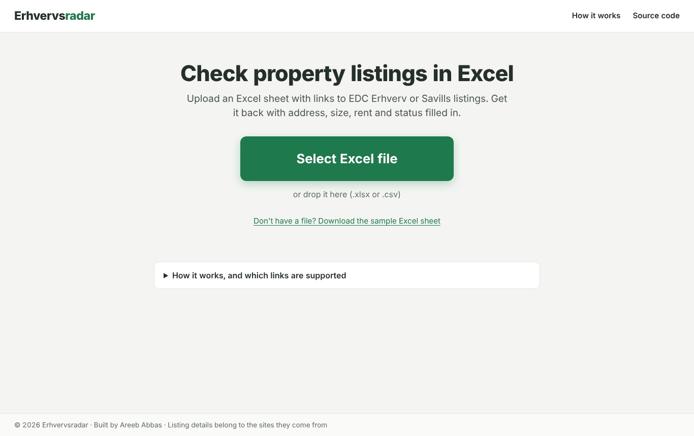
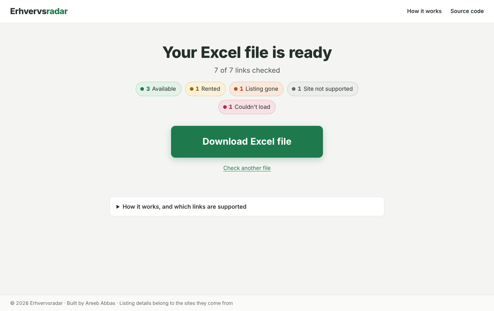
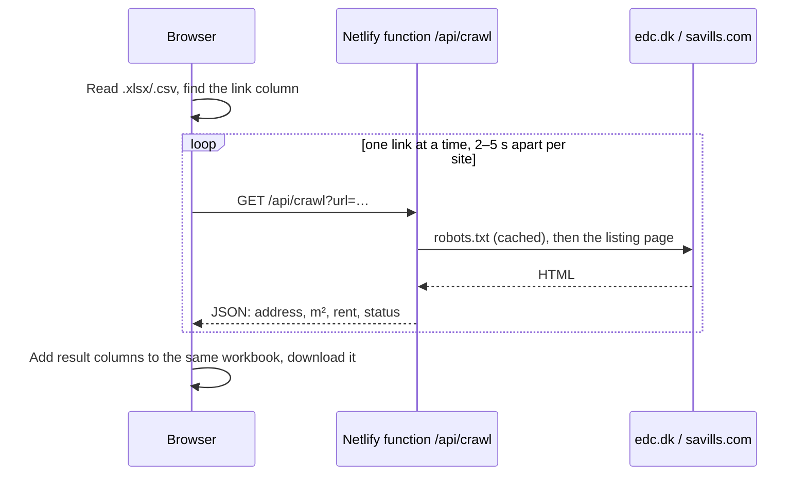

# Erhvervsradar

Upload an Excel sheet of links to Danish commercial lease listings, and get the same
sheet back with **address, size, rent and status** filled in.

**Try it:** https://YOUR-SITE.netlify.app <!-- replace after deploying -->
(click "Download the sample Excel sheet", then upload it)

| Upload | Result |
|---|---|
|  |  |

Supported sites: **EDC Erhverv** (edc.dk lease listings) and **Savills Denmark**.
Links to other sites stay in the file with a note in the Result column.

## What you get back

The same workbook, with your own columns and formatting untouched and these columns added:
Result, Address, Postcode, City, Property type, Size m², Rent per year, Rent per m², Source,
Checked at, and a Note when something went wrong. Uploading a results file again updates
those columns instead of adding them twice.

Possible results: *Available*, *Rented* (still online but let), *Listing gone* (404, or
redirected to a search page), *Not a listing page*, *Site not supported*, *Not a link*,
*Blocked by robots.txt*, and *Couldn't load*. Links that fail to load are retried
automatically up to 2 more times (after 5 and 15 seconds) before the file is marked ready.

## How it works



- **The file never leaves the browser.** It is read and written in the browser with ExcelJS;
  only the links are sent, one per request. Nothing is stored.
- **One link per function call.** Netlify functions must answer within about 10 seconds;
  one page takes 1–2 seconds, so the browser drives the loop and each call stays small.
- **Reading the pages.** Each site has a small parser (`netlify/lib/parsers.ts`). Values are
  found by the **labels a person reads** (`Etageareal`, `Årlig leje`, `Udbudspris`), not by
  CSS class names, which change with every redesign. Only the listing itself is read: EDC's
  "similar properties" widget and Savills' site menu are cut off first, so their values
  can't leak in.
- **Danish formats.** `1.402.695 kr.` becomes 1402695, `601 til 1.281 m²` becomes 601–1281,
  and CSV files from Danish Excel (semicolons) are read correctly.

## Being polite to the sites

- **Only two sites.** The function crawls only edc.dk and search.savills.com, which also
  stops it from being used as an open proxy.
- **robots.txt first**, following RFC 9309: a missing robots.txt allows crawling, an
  unreachable one means *don't crawl*.
- **Pauses:** at least 2 seconds between EDC pages and 5 seconds between Savills pages.
- **Cached answers:** each answer is cached on Netlify's CDN for an hour, so many people
  trying the same sample sheet cause one visit per listing.
- **An honest User-Agent** that names the project and gives a contact address.

## Deploy on Netlify

1. Push this repo to GitHub.
2. In Netlify: **Add new site → Import an existing project → GitHub**, and pick the repo.
   `netlify.toml` sets everything: the page is in `web/`, the function in `netlify/functions/`.
3. Open the site, download the sample sheet and upload it.

## Run it locally

```bash
npm install
npm test                  # function and parser tests, no network needed
npx netlify dev           # the page and /api/crawl on http://localhost:8888
```

## Project structure

```
web/                      the page (HTML, CSS, vanilla JS; ExcelJS vendored)
netlify/functions/        crawl.mts: GET /api/crawl?url=…
netlify/lib/              crawl.ts (robots, fetch, statuses), parsers.ts, normalize.ts
tests-js/                 Vitest tests for the function, with a fake internet
src/erhvervsradar/        the same crawler in Python (command line tool + Streamlit app)
app.py                    Streamlit version of the same page (optional, see below)
tests/                    Python tests; tests/fixtures/ holds the sample pages both test suites use
```

## Also included

- **A Python command line tool** (`src/erhvervsradar/`) that crawls *every* lease listing
  from both sites, stores them in SQLite and reports new, changed and removed listings:
  `pip install -e ".[dev]"`, then `erhvervsradar crawl --source edc --limit 20`.
- **A Streamlit version of the page** (`app.py`), in case you prefer to host it on
  Streamlit Community Cloud instead: `pip install -r requirements.txt`, then
  `streamlit run app.py`.

Both the TypeScript and the Python parsers are tested against the **same sample pages** in
`tests/fixtures/`, so they must agree on every field. The sample pages are hand-made copies
of the real page structures; to replace one with a live snapshot:
`erhvervsradar save-fixture "<listing url>" tests/fixtures/<name>.html`.

## Next steps

- **AI fallback:** when the rules can't find size or rent (for example on a site without
  labels), send the listing text to an LLM with a strict JSON schema and validate the
  answer. Only the parsing step changes; the rest stays the same.
- More sites: one new parser each.

## License

MIT. ExcelJS is MIT-licensed (`web/vendor/exceljs.LICENSE`). Listing details belong to the
sites they come from.
